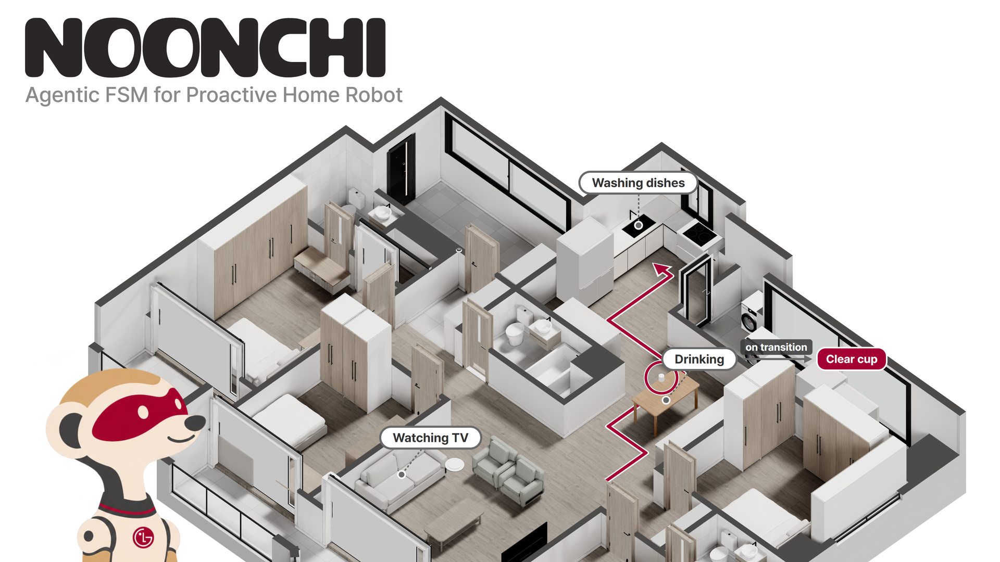

# NOONCHI

**Agentic FSM for Proactive Home Robot**  
LG Electronics · Software Engineering 26-2

NOONCHI is a prototype of the decision-making system for LG’s home robot CLOiD. It describes what the camera sees using a fixed vocabulary for posture, location, objects in hand, and the state of nearby objects. A resident sitting at the dining table, holding a cup, and bringing it to their mouth gives the robot evidence of a particular activity: drinking at the table.

NOONCHI represents the resident’s activities and the transitions between them in a finite-state machine (FSM). At the end of the day, it reviews the activity record to find tasks the resident repeatedly performs. If the resident regularly carries their cup to the sink after drinking, the system can learn to associate that transition with clearing the cup.

One day, the resident leaves the cup on the table and walks away. NOONCHI can check that the same empty cup is still there and start clearing it. **The resident’s everyday actions provide the examples. No preference entry or explicit request is needed to learn the routine.**

## Quick Links

| Link | Contents |
|---|---|
| [Code](https://github.com/noonchi-home/noonchi) | System architecture, implementation, and evaluation |
| [Wiki](https://noonchi-home.github.io/wiki/) | Project documentation |

## Team

| Name | Email | GitHub |
| --- | --- | --- |
| Jeong-O Heo | [hjo0225@hanyang.ac.kr](mailto:hjo0225@hanyang.ac.kr) | [hjo0225](https://github.com/hjo0225) |
| Jihun Shin | [szhszh0221@gmail.com](mailto:szhszh0221@gmail.com) | [jihoon0221](https://github.com/jihoon0221) |
| Seokjun Park | [david1127@hanyang.ac.kr](mailto:david1127@hanyang.ac.kr) | [seokjoon1127](https://github.com/seokjoon1127) |
| Junhyeong Kim | [humbahumba65@hanyang.ac.kr](mailto:humbahumba65@hanyang.ac.kr) | [junhyung65](https://github.com/junhyung65) |
